# MindMesh

[](https://github.com/zann06/MindMesh/actions/workflows/ci.yml)
[](https://github.com/zann06/MindMesh/actions/workflows/deploy-pages.yml)
[](LICENSE)
[](https://zann06.github.io/MindMesh/)

**Live demo:** <https://zann06.github.io/MindMesh/>

MindMesh turns what you read into an explorable, evidence-backed knowledge universe. Import a PDF or Markdown document, shape the concepts and relationships you care about, then practice them with local quizzes. Projects live in your browser. AI is optional and off by default.

MindMesh is pre-1.0 software. It is intended for local study and self-directed experimentation, not for regulated records, collaboration, or unattended production use.

<p align="center">
  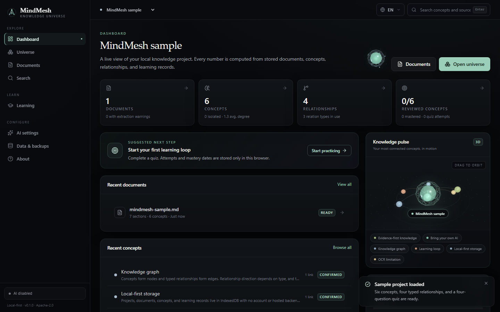
</p>

## Demo

Screenshots taken from the production build with the sample project loaded. The interface is available in English and Indonesian, uses a calm graphite and sea-glass theme, and adapts to mobile viewports.

| Dashboard | Knowledge universe |
| :---: | :---: |
|  | 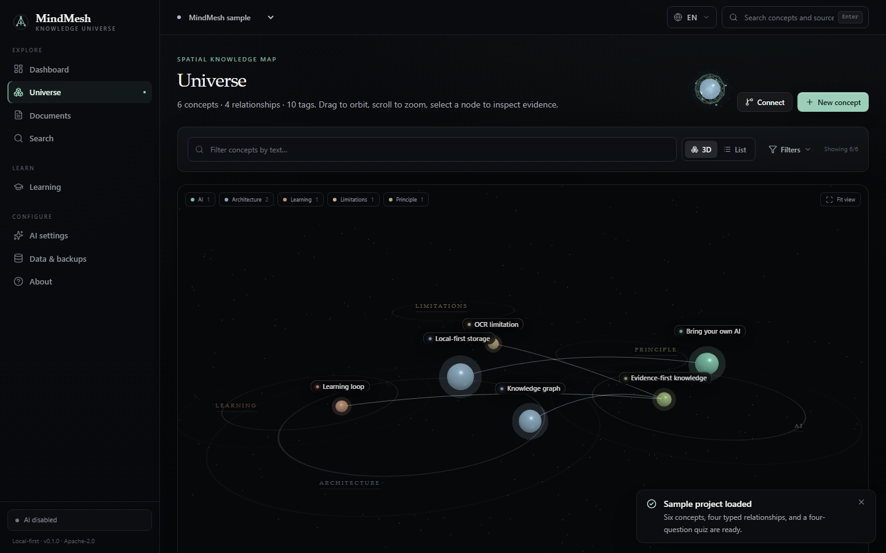 |
| **Learning** | **Search with evidence** |
| 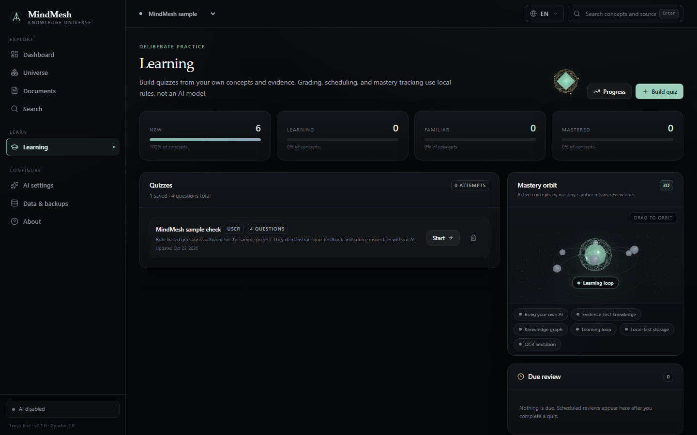 | 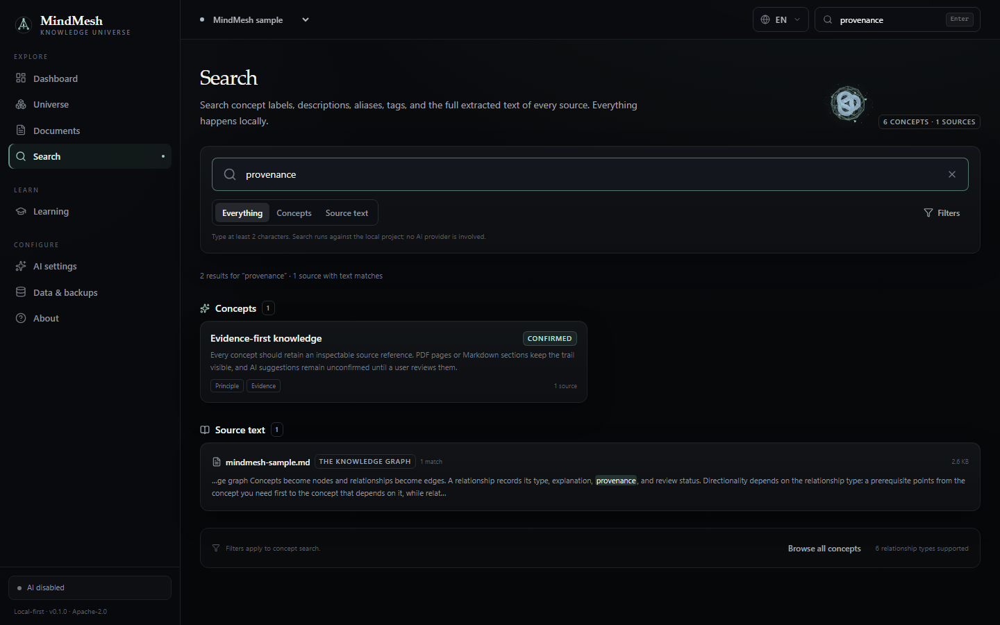 |
| **Documents** | **Document viewer** |
| 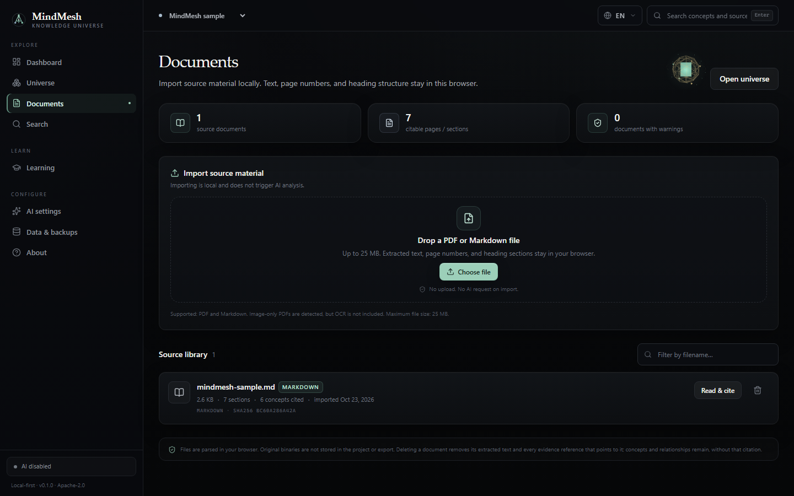 | 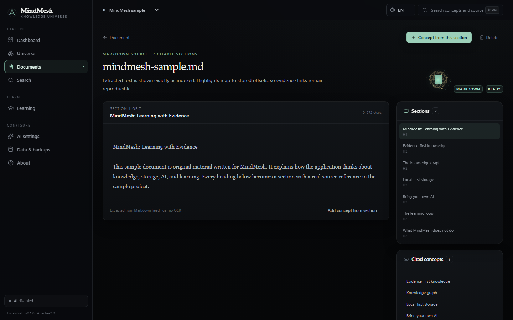 |

| Indonesian dashboard | Indonesian universe |
| :---: | :---: |
| 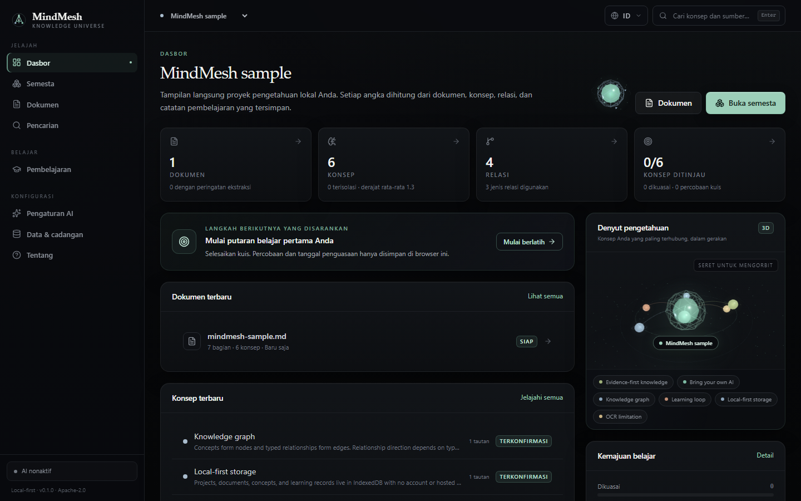 | 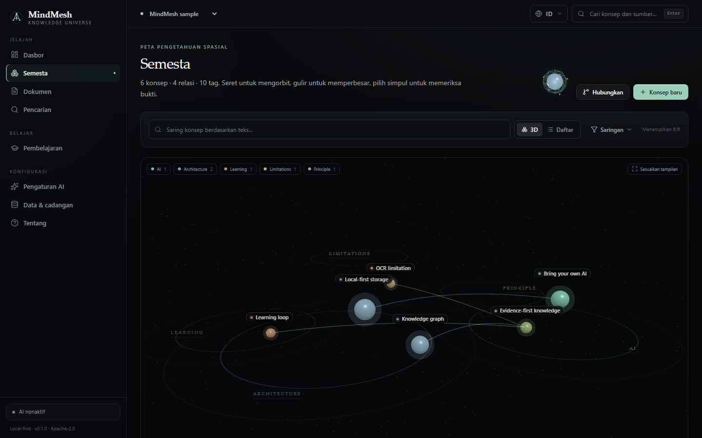 |

| Mobile dashboard | Settings | Data and backup |
| :---: | :---: | :---: |
| 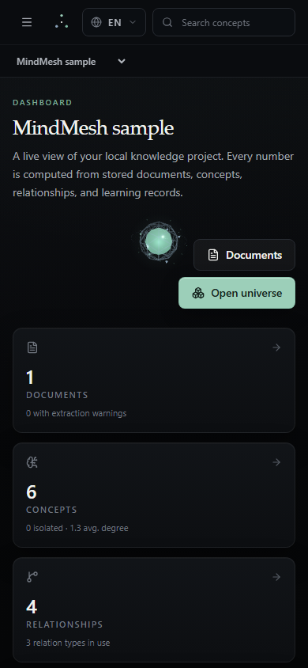 | 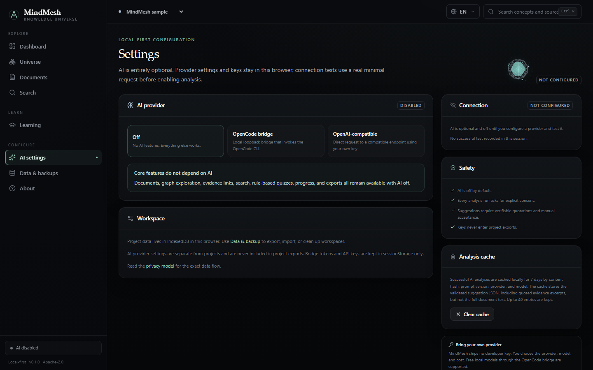 | 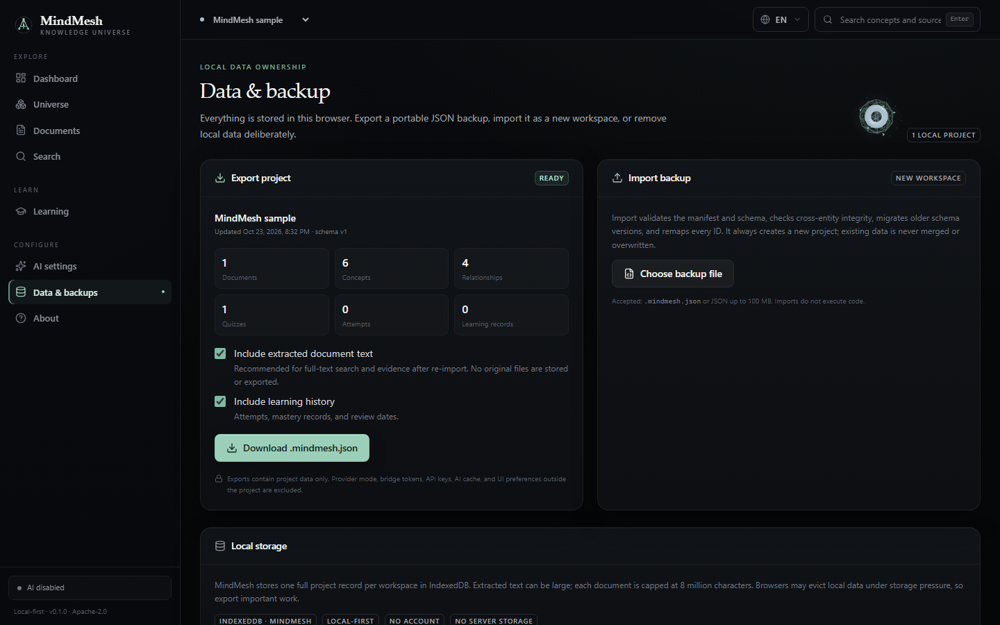 |

Refresh these captures after UI changes with `npm run screenshots`.

## Why MindMesh

- **Local-first by default.** Projects, extracted text, concepts, quizzes, and learning history are stored in IndexedDB in your browser. There is no account and no application backend.
- **Evidence stays attached.** Concepts and relationships carry source references with document IDs, offsets or page numbers, and quoted excerpts.
- **The graph is inspectable.** A deterministic 3D universe is paired with a fully accessible list view, filters, concept detail pages, and source links.
- **Practice without AI.** The rule-based quiz engine builds multiple-choice, true/false, and short-answer questions from your own records.
- **AI only when you ask.** A connection is shown only after a real test request. Sending analysis content requires per-run consent, and every response is validated before it can become a suggestion.
- **Portable data.** Export a versioned JSON backup and import it as a new workspace with every ID remapped.

## Features

### Knowledge workspace

- Multiple local projects with an active-project switcher.
- PDF and Markdown import with extracted text, sections, warnings, and content hashes.
- Document viewer with page/section evidence and concept creation from a selected passage.
- Concept and relationship editors with review status, tags, aliases, provenance, and source references.
- Full-text search across concepts and source excerpts.
- Project export, import preview, integrity validation, schema migration, and deliberate deletion controls.

### Universe

- Deterministic tag-region or sphere layouts.
- Instanced nodes and edges for larger graphs, with limited labels by default.
- Filters for text, tag, review status, source document, and relationship type.
- WebGL fallback, an error boundary, and an accessible list view with the same concepts and actions.
- Concept inspector with evidence, relationships, and navigation to the full concept page.

### Interface and accessibility

- English and Indonesian throughout the app, including quiz questions, explanations, warnings, toasts, tooltips, and accessibility labels.
- A persistent language dropdown in the header with keyboard navigation and focus handling; the choice is stored locally and `document.documentElement.lang` is kept in sync.
- `Ctrl+K` (or `Cmd+K`) focuses the global search field from anywhere in the app.
- A small interactive 3D orb in each page header: drag to rotate, click to pulse. It is lazy-loaded, respects reduced WebGL availability, and has a static CSS fallback with a localized accessible label.
- Accessible list views, labelled controls, and keyboard-reachable alternatives for the 3D views.

### Learning

- Rule-based quiz generation with selectable concepts, question types, and question limits.
- Immediate grading and explanations.
- Attempt history and local mastery records.
- Conservative mastery thresholds: `mastered` requires at least 5 attempts and 80% accuracy; `familiar` requires at least 3 attempts and 60% accuracy.
- Progress views for recent activity and concepts that need review.

### Optional AI

- **OpenCode CLI bridge:** a loopback-only local bridge that invokes the OpenCode CLI with fixed arguments.
- **OpenAI-compatible endpoint:** call a provider endpoint you own directly from the browser.
- Schema-validated suggestion output with quoted evidence checks.
- Seven-day local cache of up to 40 validated results.
- Secrets held in `sessionStorage`, not `localStorage`, project exports, or build-time environment files.

See [docs/ai-integration.md](docs/ai-integration.md) for the full trust model and bridge API.

## Quick start

Requirements:

- Node.js 24 or newer
- npm 10 or newer
- A modern browser with IndexedDB, Web Workers, and ES2022 support

```bash
npm install
npm run dev
```

Open the URL printed by Vite, typically `http://localhost:5173`.

To see the app with data immediately:

1. Select **Load sample project** on the dashboard or welcome screen.
2. Wait for the sample workspace to open in **Universe**.
3. Try **Documents**, **Search**, **Learning**, and **Data & backup**.

The sample is original MindMesh material located at `public/samples/mindmesh-sample.md`.

### Production build

```bash
npm run build
npm run preview
```

The production build is static and can be hosted on any static file host. It requires no MindMesh server.

### Hosting

The repository includes a GitHub Pages workflow at `.github/workflows/deploy-pages.yml`. On every push to `main` it builds with `VITE_BASE_PATH` set to the repository name, then copies `index.html` to `404.html` so `BrowserRouter` deep links resolve on Pages.

To enable it, open **Settings → Pages → Build and deployment** and set the source to **GitHub Actions**, then push to `main`. The live demo is at <https://zann06.github.io/MindMesh/>.

For another static host, run `npm run build` and serve `dist/`. If the app is served from a subpath, set `VITE_BASE_PATH` before building, for example `VITE_BASE_PATH=/mindmesh/ npm run build`. Browsers still need an SPA fallback that serves `index.html` for unknown paths.

## Optional OpenCode bridge

The bridge is a separate local process. It is never required for core features.

```bash
npm run bridge
```

The process prints:

- a loopback URL, by default `http://127.0.0.1:4319`
- a per-run token, unless `MINDMESH_BRIDGE_TOKEN` is set
- whether an OpenCode CLI binary was found

Then open **Settings → AI providers**, choose **OpenCode CLI bridge**, enter the URL and token, and select **Test connection**. A minimal real request is sent through the bridge. The UI does not report a connection from a stored flag alone.

The bridge:

- binds to `127.0.0.1` only
- requires the token on every endpoint, including `/health`
- restricts browser origins to the configured list
- validates request bodies and limits prompt size, output size, concurrency, and duration
- invokes OpenCode with `shell: false` and fixed arguments from a temporary sandbox directory
- does not store prompts or responses

A local bridge does not necessarily mean a local model. OpenCode may be configured to use a remote provider, so review your OpenCode configuration before sending private material.

Environment variables are documented in [.env.example](.env.example). Never put a provider key in a public build.

## Commands

| Command | Purpose |
| --- | --- |
| `npm run dev` | Start the Vite development server |
| `npm run build` | Type-check and create the production bundle in `dist/` |
| `npm run preview` | Serve the production bundle locally |
| `npm run typecheck` | Run TypeScript with no emit |
| `npm run lint` | Run ESLint over the repository |
| `npm test` | Run unit and integration tests with Vitest |
| `npm run test:watch` | Run Vitest in watch mode |
| `npm run test:e2e` | Run Playwright tests against a production preview on port 4373 |
| `npm run test:e2e:ui` | Open the Playwright UI |
| `npm run screenshots` | Build and refresh the README screenshots in `docs/screenshots/` |
| `npm run verify` | Lint, type-check, unit/integration tests, and production build |
| `npm run verify:full` | `verify` plus the Playwright end-to-end suite |
| `npm run bridge` | Start the local OpenCode bridge |

Install the Playwright browser once before running E2E tests:

```bash
npx playwright install chromium
```

The E2E configuration starts `vite preview` on `127.0.0.1:4373` and expects a current `dist/` build. Run `npm run build` first when invoking Playwright directly.

## Testing

The test suite covers:

- graph layout, filtering, degrees, and statistics
- Markdown parsing and sanitization
- quiz generation and grading in English and Indonesian
- interactive feature orbs and localized page labels
- project export/import integrity and ID remapping
- IndexedDB schema migration and validation
- workspace lifecycle, sample loading, and immutable learning updates
- PDF text extraction, image-only warnings, invalid files, and cancellation
- local bridge authentication, CORS, limits, and request validation
- Playwright core flow and quiz flow in a production build

See [docs/testing.md](docs/testing.md) for details and known non-fatal warnings.

## Data model

A project is a versioned JSON record with:

- documents and extracted text sections
- concepts with aliases, tags, descriptions, provenance, review status, and source references
- typed relationships: `prerequisite`, `part-of`, `related-to`, `contrasts-with`, `causes`, `example-of`
- quizzes, questions, attempts, and learning records
- project preferences

IndexedDB database: `mindmesh`  
Object store: `projects`  
Index: `by-updated`

Original file binaries are not stored. Only extracted text and metadata are retained.

Imports always create a new project. MindMesh validates the manifest, migrates supported older schema versions, checks cross-entity integrity, and remaps every document, concept, relationship, quiz, question, attempt, and learning-record ID. Existing projects are never merged or overwritten.

## Architecture

```text
src/
  app/                 application shell, routes, Zustand stores
  components/          layout and UI primitives
  core/                domain types, factories, schemas, integrity, storage, import/export
  features/            dashboard, documents, graph, universe, learning, settings, data, about
  services/
    ai/                providers, chunking, prompts, cache, validation
    document-parser/   Markdown, PDF, hashing
    graph-engine/      layout, filtering, statistics
    quiz-engine/       rule-based generation
  test/                Vitest environment setup
bridge/                loopback OpenCode bridge
tests/                 unit, integration, and Playwright tests
docs/                  architecture, AI, and testing notes
```

Heavy routes and libraries are lazy-loaded. PDF.js is loaded only when a PDF is parsed, and the 3D renderer is loaded only when the 3D view is available and selected.

A more detailed walkthrough is in [docs/architecture.md](docs/architecture.md).

## Privacy and security

- No analytics, advertising, session recording, or third-party scripts are implemented.
- Importing and core study features make no AI request.
- The app has no backend and no server-side storage.
- AI secrets are stored in `sessionStorage`; they are cleared when the tab session ends.
- Exports contain project data only. Provider endpoints, modes, tokens, API keys, and the AI cache are excluded.
- Provider credentials and AI settings are not included in project records.
- AI analysis requires explicit consent for each run.
- All AI output is treated as untrusted input and schema-validated before review.

MindMesh cannot protect against browser extensions, device backups, browser sync, malware, or other software with access to your browser profile. Browser storage can be evicted. Export backups for anything important.

Read [the in-app privacy model](src/features/about/privacy-page.tsx) and [SECURITY.md](SECURITY.md).

## Limitations

- **No OCR.** Image-only or scanned PDFs may be stored, but with no selectable text they cannot be searched or cited. MindMesh reports this rather than inventing content.
- **No cloud sync or collaboration.** There are no user accounts, shared workspaces, or server-side recovery.
- **No AI by default.** Without a configured provider, AI analysis is unavailable; core knowledge and quiz features remain available.
- **Short-answer grading is approximate.** It uses key-term overlap, not semantic grading. It is a study aid, not an assessment authority.
- **3D is optional.** WebGL may be unavailable. The list view is the complete, accessible interface.
- **Storage is browser-scoped.** Clearing site data removes local projects. Exports are the durable backup.

## Contributing

Contributions are welcome. Read [CONTRIBUTING.md](CONTRIBUTING.md) and [CODE_OF_CONDUCT.md](CODE_OF_CONDUCT.md) before opening a change. For security issues, follow [SECURITY.md](SECURITY.md) instead of filing a public issue.

## License

Apache License 2.0. See [LICENSE](LICENSE).
